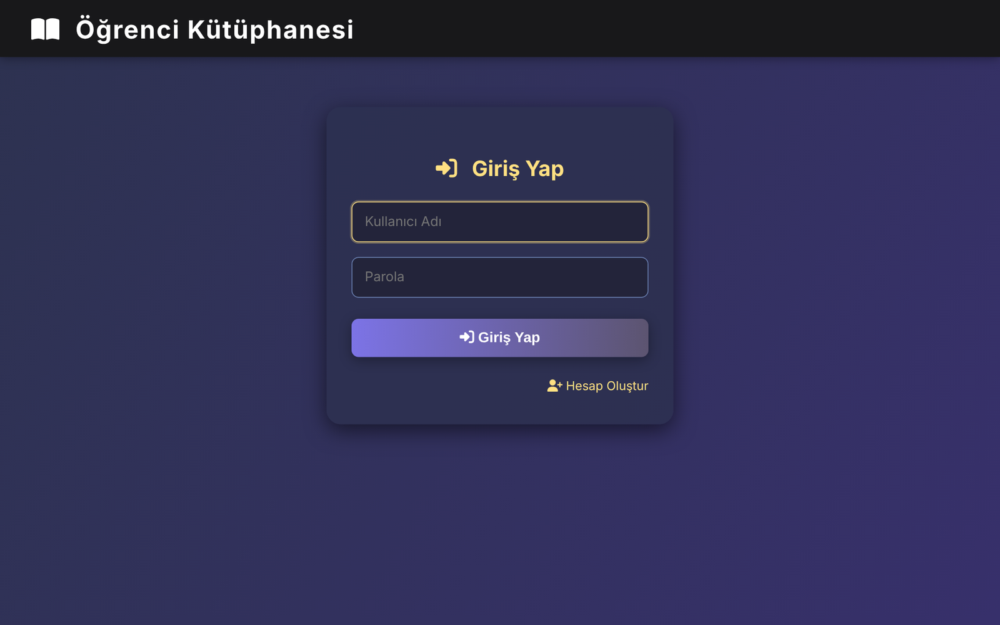
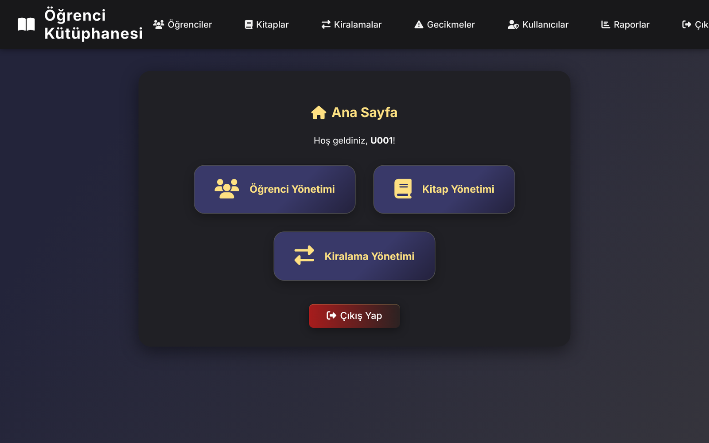
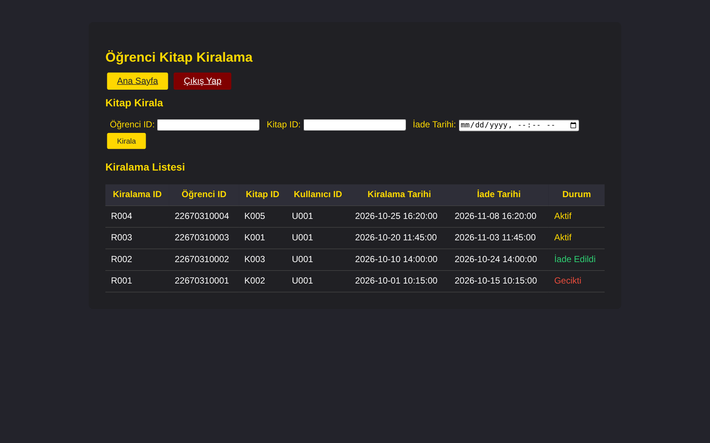
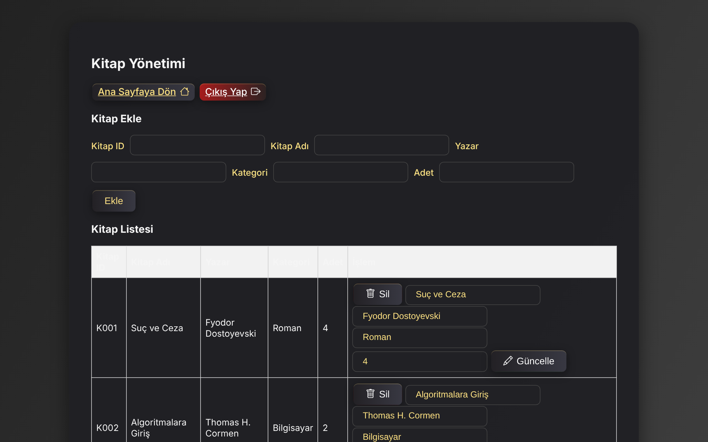
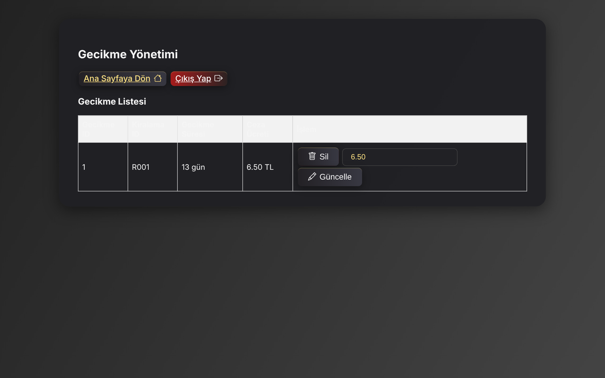

# Student Book Rental System

A PHP and MySQL web application for managing book rentals to students: inventory, rentals, returns, late fees and reports.

## Screenshots

| Login | Dashboard |
|---|---|
|  |  |

| Rentals | Books |
|---|---|
|  |  |

*Screenshots use demo data.*

## Features

- **Users and roles**: register, log in and log out, with session-based access control
- **Books** (Kitaplar): manage titles and stock
- **Students** (Öğrenciler): manage student records
- **Rentals** (Kiralama): rent a book with a stock check and a due date
- **Returns** (İade): mark books as returned
- **Late returns** (Gecikmeler): track overdue rentals and late fees
- **Reports** (Raporlar): rental statistics

Database access uses `mysqli` prepared statements throughout, and passwords are stored as bcrypt hashes (`password_hash` / `password_verify`). Existing plain-text passwords are upgraded to hashes automatically on the user's next login.

## Setup

1. Install XAMPP (or any PHP and MySQL stack).
2. Create a database named `ogrenci_kitap` with the tables `kullanicilar`, `kitaplar`, `ogrenciler` and `kiralamalar`. The `kullanicilar.parola` column must be at least `VARCHAR(255)` to hold password hashes.
3. Copy the project into `htdocs/` and update the credentials in `db_connect.php` if needed.
4. Open `http://localhost/student-bookshop/giris.php`.

## Roadmap

- [ ] Add a SQL schema file for one-step setup
